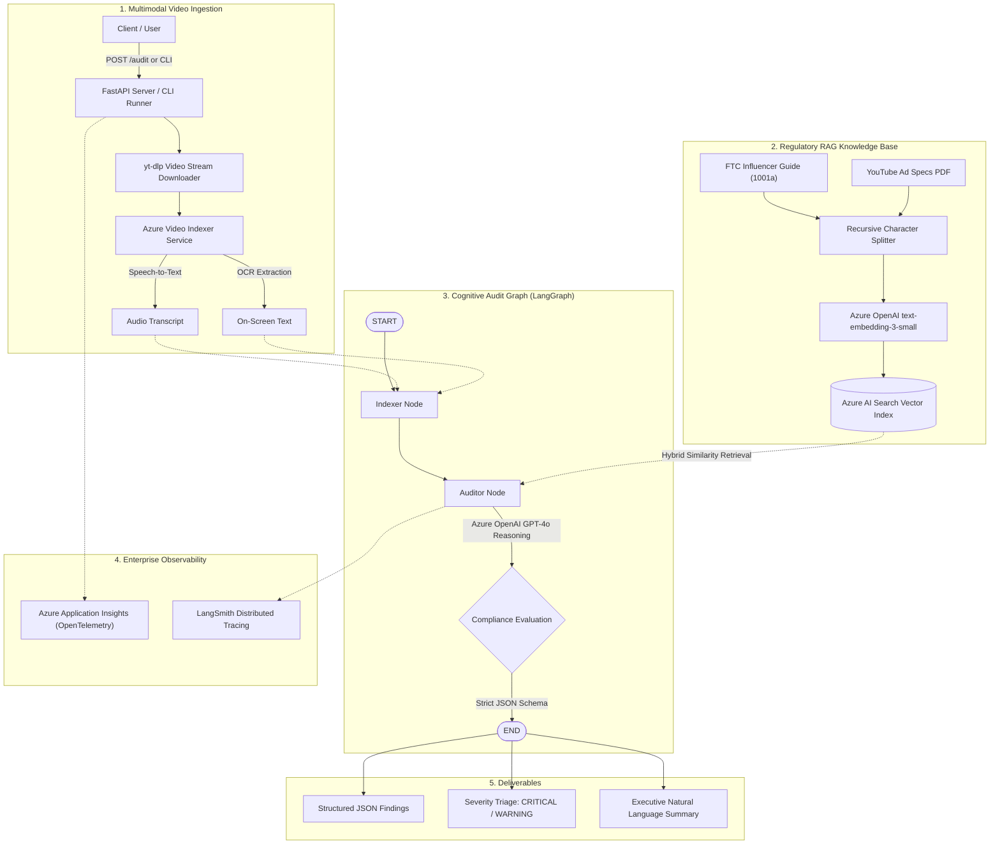

# 🛡️ Brand Guardian AI

> **Autonomous Multimodal Video Compliance & QA Pipeline powered by LangGraph, Azure OpenAI, Azure Video Indexer, and Azure AI Search.**

[](https://www.python.org/)
[](https://fastapi.tiangolo.com)
[](https://github.com/langchain-ai/langgraph)
[](https://azure.microsoft.com/)
[](https://azure.microsoft.com/)
[](https://opentelemetry.io/)
[](https://opensource.org/licenses/MIT)

---

## 📌 Executive Summary

Modern enterprise brands and marketing teams publish hundreds of video campaigns and influencer collaborations every week across YouTube, Instagram, and TikTok. Non-compliance with **FTC Endorsement Guides (16 CFR Part 255)**, false advertising laws, or platform-specific ad specifications poses massive legal, financial, and reputational risks.

**Brand Guardian AI** is an enterprise-grade agentic auditing system that automates the end-to-end video compliance review process:
1. **Ingests & Extracts**: Stream-downloads video assets and extracts audio transcripts (Speech-to-Text) and on-screen text (OCR) via Azure Video Indexer.
2. **Grounds Knowledge (RAG)**: Retrieves authoritative regulatory guidelines (FTC Guides, YouTube Advertising Specs) using vector similarity search in Azure AI Search.
3. **Audits with Cognitive Graphs**: Leverages a stateful LangGraph Directed Acyclic Graph (DAG) powered by Azure OpenAI GPT-4o to evaluate spoken and visual claims against retrieved legal requirements.
4. **Delivers Actionable Reports**: Generates structured, severity-rated compliance reports (`CRITICAL`, `WARNING`, `PASS`) with mitigation recommendations.
5. **Full Observability**: Tracks every workflow step and API request using Azure Application Insights, OpenTelemetry, and LangSmith tracing.

---

## 🏛️ System Architecture



---

## ✨ Key Features & Capabilities

- **🎥 Multimodal Signal Processing**: Extracts and evaluates synchronized auditory dialogue (Speech-to-Text) and visual text overlays (OCR) simultaneously.
- **📚 Grounded Vector RAG**: Prevents LLM hallucinations by retrieving exact clauses from official regulatory PDFs (FTC Endorsement Guides and YouTube Specs) indexed in Azure AI Search.
- **🧠 Stateful LangGraph State Machine**: Implements `VideoAuditState` TypedDict with append-only issue trackers (`operator.add`), enabling deterministic multi-step audit execution.
- **🎯 Strict Output Schema Validation**: Enforces JSON response contracts categorized by severity (`CRITICAL`, `WARNING`), violation category, specific description, and PASS/FAIL status.
- **🔭 End-to-End Observability**: Auto-instruments FastAPI routes and Azure dependencies via OpenTelemetry, streaming telemetry to Azure Monitor and execution trees to LangSmith.
- **🚀 Production-Ready Interfaces**: Provides both a rapid CLI simulation runner for local inspection (`main.py`) and a production ASGI FastAPI web service (`server.py`) with OpenAPI Swagger documentation.

---

## 📂 Repository Structure

```text
Brand_Guardian/
├── README.md                           # Comprehensive documentation & architecture guide
├── pyproject.toml                      # Project metadata & dependency definitions (PEP 621)
├── uv.lock                             # Reproducible lockfile for uv package manager
├── .python-version                     # Python target version (3.12)
├── .env.example                        # Template for required environment variables
├── .gitignore                          # Version control exclusion rules
├── main.py                             # Interactive CLI simulation runner entry point
│
├── backend/
│   ├── Dockerfile                      # Containerization specification for cloud deployment
│   ├── data/                           # Regulatory compliance policy documents
│   │   ├── 1001a-influencer-guide-508_1.pdf  # FTC Influencer Compliance Guide
│   │   └── youtube-ad-specs.pdf        # Official YouTube Advertising Guidelines
│   │
│   ├── scripts/                        # Ingestion & knowledge base initialization
│   │   ├── index_documents.py          # ETL script chunking & vectorizing PDFs to Azure AI Search
│   │   └── explanation.txt             # Ingestion verification and architectural notes
│   │
│   ├── src/
│   │   ├── api/                        # Web service layer
│   │   │   ├── __init__.py
│   │   │   ├── server.py               # FastAPI application with /audit and /health endpoints
│   │   │   └── telemetry.py            # Azure Monitor & OpenTelemetry configuration
│   │   │
│   │   ├── graph/                      # Cognitive reasoning layer (LangGraph)
│   │   │   ├── __init__.py
│   │   │   ├── state.py                # TypedDict schemas (VideoAuditState, ComplianceIssue)
│   │   │   ├── nodes.py                # Graph execution nodes (Indexer, Auditor with RAG)
│   │   │   └── workflow.py             # Compiled LangGraph DAG state machine
│   │   │
│   │   └── services/                   # Cloud integrations & third-party connectors
│   │       ├── __init__.py
│   │       └── video_indexer.py        # Azure Video Indexer & yt-dlp downloader service
│   │
│   └── tests/                          # Automated test suite
│       ├── __init__.py
│       └── test_audit.py               # Unit tests for state schemas and models
│
└── azure_functions/                    # Serverless event trigger extensions
    ├── function_app.py                 # Azure Functions HTTP/Blob video event handler
    ├── host.json                       # Functions runtime settings
    ├── local.settings.json             # Local function development template
    └── requirements.txt                # Function runtime dependencies
```

---

## 🛠️ Technology Stack

| Domain | Technology | Purpose |
| :--- | :--- | :--- |
| **Language & Runtime** | Python 3.12+ | Core execution environment |
| **Package Management** | [uv](https://docs.astral.sh/uv/) | Blazing fast dependency resolution & virtualenv management |
| **Agentic Framework** | [LangGraph](https://github.com/langchain-ai/langgraph) / [LangChain](https://www.langchain.com/) | Stateful cognitive Directed Acyclic Graph orchestration |
| **LLM Reasoning** | Azure OpenAI (GPT-4o) | High-precision regulatory rule interpretation |
| **Embedding Model** | Azure OpenAI (`text-embedding-3-small`) | High-dimensional semantic vector representations |
| **Vector Database** | Azure AI Search (Cognitive Search) | Hybrid semantic & vector search for compliance corpus |
| **Video Intelligence** | Azure Video Indexer | Audio transcription (STT) and OCR visual text extraction |
| **Media Ingestion** | `yt-dlp` & `ffmpeg` | Robust video stream fetching and pre-processing |
| **API Framework** | FastAPI & Uvicorn | High-performance asynchronous REST API |
| **Observability** | Azure Monitor, OpenTelemetry, LangSmith | Distributed tracing, APM, and LLM call inspection |
| **Containerization** | Docker | Portable, cloud-native deployment image |

---

## ⚡ Quickstart & Setup Guide

### 1. Prerequisites
- **Python 3.12** or higher installed.
- **FFmpeg** installed on your system (required by `yt-dlp` for video extraction):
  - macOS: `brew install ffmpeg`
  - Ubuntu/Debian: `sudo apt update && sudo apt install -y ffmpeg`
  - Windows: `winget install Gyan.FFmpeg`
- An active **Microsoft Azure subscription** with:
  - Azure OpenAI (deployments for `gpt-4o` and `text-embedding-3-small`)
  - Azure AI Search resource
  - Azure Video Indexer account
  - Azure Application Insights (optional, for telemetry)

### 2. Clone the Repository
```bash
git clone https://github.com/MallaManoj/Brand_Guardian.git
cd Brand_Guardian
```

### 3. Environment Configuration
Create your local `.env` file from the provided template:
```bash
cp .env.example .env
```
Fill in your Azure and OpenAI credentials inside `.env`:
```env
AZURE_OPENAI_API_KEY="your-key"
AZURE_OPENAI_ENDPOINT="https://<your-resource>.openai.azure.com/"
AZURE_OPENAI_CHAT_DEPLOYMENT="gpt-4o"
AZURE_OPENAI_EMBEDDING_DEPLOYMENT="text-embedding-3-small"

AZURE_SEARCH_ENDPOINT="https://<your-search-service>.search.windows.net"
AZURE_SEARCH_API_KEY="your-key"
AZURE_SEARCH_INDEX_NAME="compliance-knowledge-index"

AZURE_VI_ACCOUNT_ID="your-vi-account-id"
AZURE_VI_LOCATION="eastus"
AZURE_SUBSCRIPTION_ID="your-subscription-id"
AZURE_RESOURCE_GROUP="your-resource-group"
```

### 4. Install Dependencies
Using **uv** (recommended):
```bash
uv sync
```
Or using standard **pip**:
```bash
python -m venv .venv
source .venv/bin/activate  # On Windows: .venv\Scripts\activate
pip install -r pyproject.toml
```

---

## 🚀 Running the Pipeline

### Step 1: Initialize the Regulatory Vector Knowledge Base (ETL)
Index the official FTC and YouTube policy PDFs into Azure AI Search:
```bash
uv run python backend/scripts/index_documents.py
```
*Output: Chunks documents into 37 semantically bounded passages and uploads vectors to Azure AI Search.*

### Step 2: Run the Local CLI Audit Simulation
Audit a sample video through the full LangGraph workflow:
```bash
uv run python main.py
```

### Step 3: Launch the Production FastAPI Server
Start the asynchronous API with hot reload:
```bash
uv run uvicorn backend.src.api.server:app --reload --port 8000
```
- Interactive Swagger UI: `http://localhost:8000/docs`
- Service Health Check: `http://localhost:8000/health`

---

## 📡 API Reference

### `POST /audit`
Trigger an automated compliance audit on a video URL.

#### Request Payload:
```json
{
  "video_url": "https://youtu.be/dT7S75eYhcQ"
}
```

#### Response Payload (200 OK):
```json
{
  "video_id": "vid_ce6c43bb",
  "status": "FAIL",
  "compliance_results": [
    {
      "category": "FTC Disclosure Violation",
      "severity": "CRITICAL",
      "description": "Video includes sponsored product promotion without a clear and conspicuous disclosure in the first 30 seconds or above the fold in the description (FTC 16 CFR § 255.5)."
    },
    {
      "category": "Substantiation & Guarantees",
      "severity": "WARNING",
      "description": "On-screen text displays '100% Guaranteed Results' without accompanying scientific substantiation or standard disclaimer."
    }
  ],
  "final_report": "The submitted video fails compliance requirements due to 1 critical FTC disclosure omission and 1 unsubstantiated efficacy guarantee. Immediate remediation is required prior to public distribution."
}
```

---

## 🧪 Running Automated Tests

Run the test suite to verify state schemas and data models:
```bash
python -m unittest discover backend/tests
```

---

## 🐳 Docker Deployment

Build and run the containerized service:
```bash
# Build Docker image
docker build -t brand-guardian:latest -f backend/Dockerfile .

# Run container on port 8000
docker run -p 8000:8000 --env-file .env brand-guardian:latest
```

---

## 🛡️ Enterprise Design Highlights

- **Deterministic Agent Control**: Rather than using an unconstrained ReAct loop, Brand Guardian uses **LangGraph StateGraph** to guarantee that regulatory retrieval strictly precedes audit reasoning, preventing hallucinations.
- **Fail-Safe Observability**: Telemetry initialization safely handles missing keys and decouples logging from operational logic.
- **Clean Architecture Separation**: Pure separation between service communication (`services/`), cognitive graph logic (`graph/`), REST API routes (`api/`), and configuration.

---

## 👨‍💻 Author & Contact

**Malla Manoj**
- **Email**: [mallamanoj718@gmail.com](mailto:mallamanoj718@gmail.com)
- **GitHub**: [@MallaManoj](https://github.com/MallaManoj)
- **Project**: [Brand_Guardian](https://github.com/MallaManoj/Brand_Guardian)
